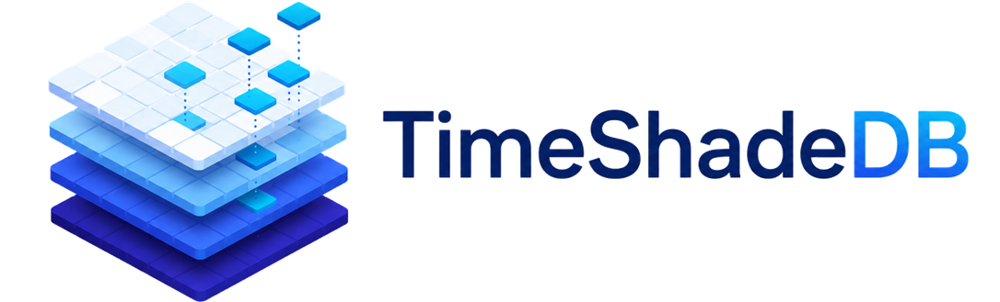

<picture>
  <source media="(prefers-color-scheme: dark)" srcset="./web/images/logo_dark_transparent.png">
  
</picture>

# TimeShadeDB

TimeShadeDB records a Factorio map over time and lets you scroll back through its history in the browser. It stores the map chart, trains, vehicles, players, chart tags, machine recipes and optionally rails. Trains are drawn on the rails, also between samples.

It is one Go binary that stores the data, serves the HTTP API and embeds a WebGL viewer. It runs next to a single game, or as a [Clusterio plugin](clusterio/README.md) for a whole cluster.

## Recording a single game

1. Install the `timeshadedb_exporter` mod (build it with `node capture/build.mjs`, see [capture/README.md](capture/README.md)). It writes the capture to `script-output/timeshade/`.
2. Start the server and forward the capture to it:

```sh
timeshadedb serve --db mymap
timeshadedb tail --dir <factorio user data>/script-output/timeshade --map mymap
```

3. Open http://127.0.0.1:8080.

`serve` listens on loopback by default. Any other address needs `--ingest-token`, and `--read-token` protects reads. `--mem-budget` (default 256 MiB) bounds the caches and buffers. Ingest is not throttled by memory. Open windows past their share of the budget are spilled to disk instead.

`tail` posts complete capture files and deletes them once the server has them. If the forwarder or the server is down, the backlog is sent later and stored at the times it was captured, as long as each source sends in time order. A forwarder may stay away for up to `--source-hold` (default 1 hour) before the server stops waiting for it. To replay a recorded capture, run `serve --clock data` and `tail --once`.

## Clusterio

The plugin in [clusterio/](clusterio/README.md) runs `timeshadedb serve` as a sidecar on the controller, records every instance through a save-patch module and shows the map on a page in the Clusterio web UI. Gridworld worlds become one map, and trains crossing Universal Edges keep their journey.

## Publishing a static map

`timeshadedb publish` exports a database as static files, to a directory or an S3/R2 bucket, so a CDN can serve the map without a server. It uploads each immutable file once and mutable files only when they change.

```sh
timeshadedb publish --db mymap --dir C:\www\map
timeshadedb publish --from http://127.0.0.1:8080/api/v3/ --every 1m --s3-endpoint https://<account>.r2.cloudflarestorage.com --s3-bucket map --state publish-state
```

See [internal/publish/README.md](internal/publish/README.md) for the flags.

## Importing an illisis/minimap export

`timeshadedb import-minimap` reads an illisis/minimap S3 export (the directory with `maps.json.gz`) into a new database: terrain, movers, tags, recipes and icons.

```sh
timeshadedb import-minimap --db mymap --verify D:\minimap-export
```

`--db` must be empty or not exist. `--verify` compares the result with the export. Without `--db` the import runs in memory, which only checks the export.

## Building

```powershell
powershell.exe -ExecutionPolicy Bypass -File scripts\build.ps1
```

This builds the web bundle, the Go binary with the bundle embedded and the Factorio mod, and writes zips to `build/packages/`. By hand:

```sh
npm --prefix web ci && npm --prefix web run build
go build ./cmd/timeshadedb
node capture/build.mjs
```

`timeshadedb help` lists the commands and `timeshadedb <command> -h` their flags.

## Releasing

A version bump on master is a release. Once CI passes, the Release workflow publishes each artifact whose version is not out yet, and tags it:

| Artifact | Version in | Published to | Tag |
|---|---|---|---|
| The Factorio mod | `capture/mod/timeshadedb_exporter/info.json`, with `capture/clusterio_module/module.json` and `capture.VERSION` in `capture/lua/capture.lua` (the build checks that the three match) | Factorio Mod Portal | `factorio-v<version>` |
| The Clusterio plugin and its binary packages | `clusterio/package.json` (`npm version patch --no-git-tag-version` in `clusterio/`) | npm | `clusterio-v<version>` |

So the mod and the plugin release on their own. Both carry the capture Lua: the mod for single games, the plugin's save-patch module for Clusterio. A capture fix needs both bumped to reach both. The workflow can also be run by hand from GitHub Actions to retry a release that failed.

Each run that releases something also makes a GitHub release, on the plugin's tag, or on the mod's when only the mod was released. It carries the mod zip, the timeshadedb binaries (`timeshadedb-<version>-<os>-<arch>`, the same ones as the npm binary packages) and `SHA256SUMS`. What the run did not release comes from the previous GitHub release, so the latest one always has both.

The mod needs the secret `FACTORIO_MOD_PORTAL_API_KEY` in the `factorio-mod-portal` environment: an API key with the `ModPortal: Publish Mods` permission (the first release) and `ModPortal: Upload Mods` (every version after it).

npm uses trusted publishing, so there is no token. npm only takes a trusted publisher for a package it already has, so a new package is published once by hand: `npm login`, then `node clusterio/scripts/publish.mjs` (it builds, tests and publishes what npm does not have at the version, and `--dry-run` shows what it would publish). Then add a trusted publisher on npmjs.com to each of `timeshade` and `@danielv123/timeshade-{win32-x64,linux-x64,linux-arm64,darwin-x64,darwin-arm64}`: repository `Danielv123/TimeShadeDB`, workflow `release.yml`, no environment.

## Documentation

| | |
|---|---|
| [docs/README.md](docs/README.md) | Repository layout and the code contracts between the parts |
| [docs/API.md](docs/API.md) | The HTTP API, live events, ingest and the static export |
| [docs/PROTOCOL.md](docs/PROTOCOL.md) | Capture envelopes from the game to the server |
| [docs/FORMAT.md](docs/FORMAT.md) | Terrain semantics, the on-disk layout and the wire formats |
| [docs/RAIL-GEOMETRY.md](docs/RAIL-GEOMETRY.md) | How trains are placed on the rails |
| [capture/README.md](capture/README.md) | The capture Lua, the mod and the Clusterio module |
| [clusterio/README.md](clusterio/README.md) | The Clusterio plugin |
| [bench/README.md](bench/README.md) | Benchmarks and the acceptance suite |
